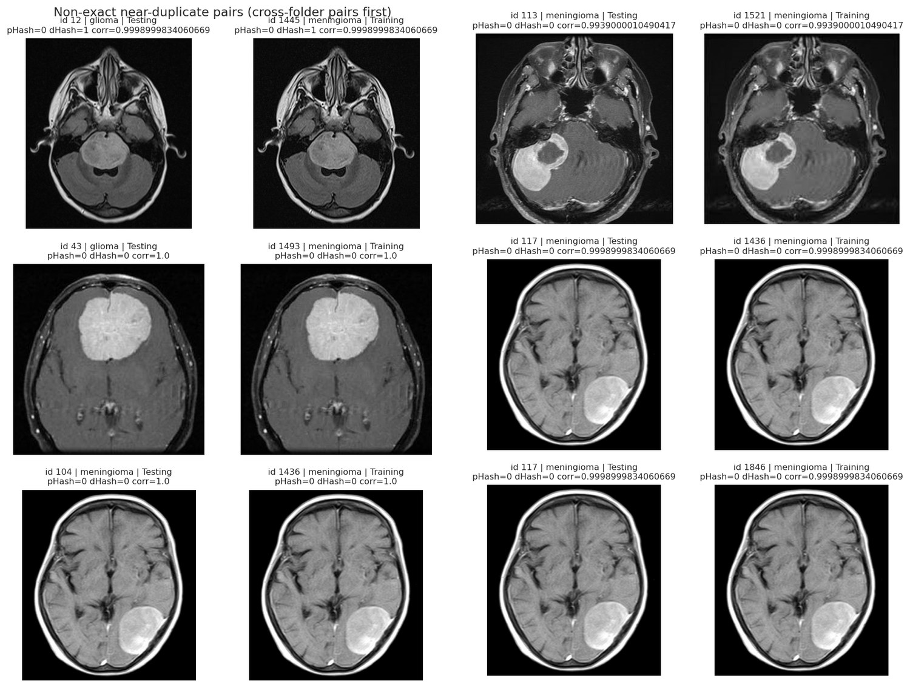
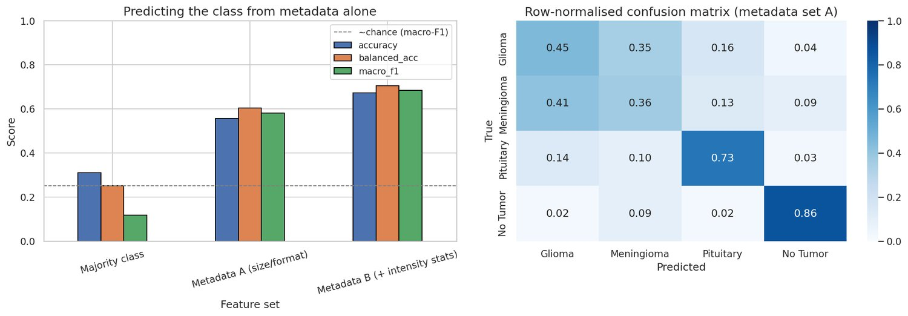
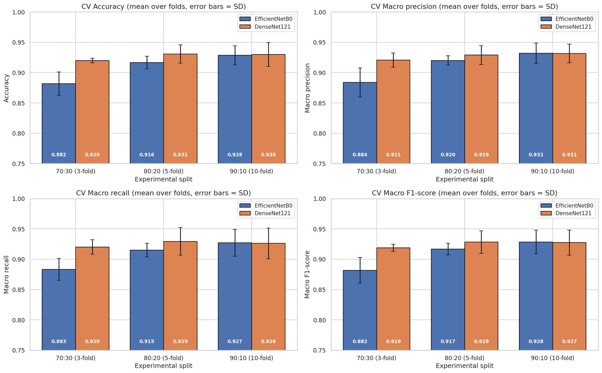
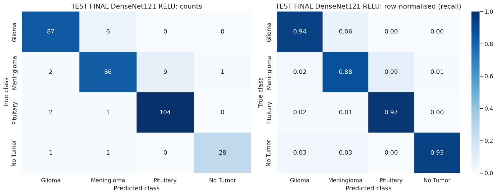
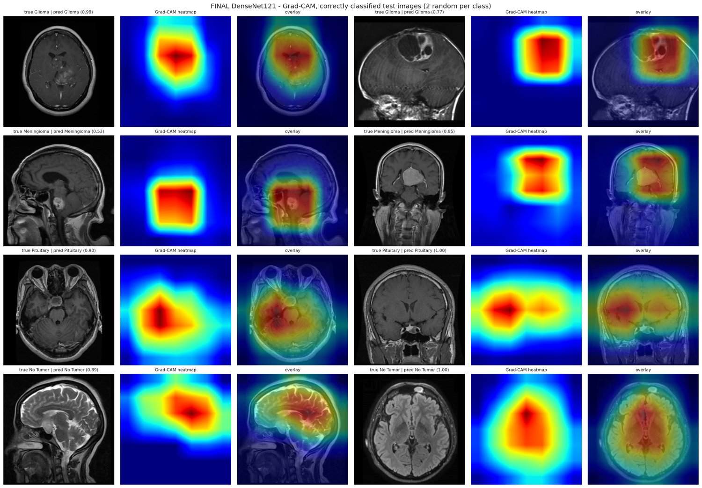

# Brain Tumor Detection and Classification Using MRI Images

    

A leakage-aware comparison of a custom four-block CNN and ImageNet-pretrained models (ResNet50, VGG19, DenseNet121, EfficientNetB0) on the Kaggle four-class brain MRI dataset (glioma, meningioma, pituitary tumour, no tumour). The project includes ReLU versus GELU experiments, stratified cross-validation, Grad-CAM, a saved final model and a prediction script.

**Minor Project-I** | B.Tech (Artificial Intelligence), Third Year, Fifth Semester
Interdisciplinary Centre for Artificial Intelligence, Zakir Husain College of Engineering and Technology (ZHCET), Aligarh Muslim University, Aligarh
**Author:** Farhan Ahmad Ansari (Enrolment GQ0173, Faculty No. 24AIBEA131) | **Supervisor:** Professor Rashid Ali

> **Educational research prototype. It is not a clinically validated diagnostic system.**

📄 **Full report:** [`report/Minor_Project_I_Report_Farhan_Ahmad_Ansari.pdf`](report/Minor_Project_I_Report_Farhan_Ahmad_Ansari.pdf)

---

## Why this project
The reference study (Anand et al., *Scientific Reports* 16:4709, 2026) reports 98.5% accuracy for a custom CNN. Inspection of the dataset showed that **268 of the 394 images (68%) in its original Testing folder have an exact or near-duplicate in the Training folder**, so results on that folder are inflated. This project removes duplicates, groups near-duplicates, builds nested class-stratified, group-aware splits (about 70:30, 80:20 and 90:10), saves the model-selection rules before any test evaluation, and reports what remains.

## Key results
| Item | Result |
|---|---|
| Cleaned dataset | 2,870 images in 2,095 duplicate groups (394 pixel-identical copies removed) |
| Cross-validated accuracy, pretrained models | about 0.88 to 0.93 |
| Custom four-block CNN | about 0.79 validation macro-F1, below the pretrained models |
| ReLU vs GELU | no detectable difference |
| **Final model** | **DenseNet121, ReLU head, trained on 90:10: test accuracy 0.930 (95% CI 0.897 to 0.953), macro-F1 0.933, 328 test images** |

The reference paper's ranking was not reproduced. Several architectures are statistically indistinguishable.

### Cross-validation (held-out folds, mean ± SD)
| Split | Model | Accuracy |
|---|---|---|
| 70:30 (3-fold) | EfficientNetB0 (GELU) / DenseNet121 (ReLU) | 0.882 ± 0.019 / 0.920 ± 0.004 |
| 80:20 (5-fold) | EfficientNetB0 (ReLU) / DenseNet121 (GELU) | 0.917 ± 0.011 / 0.931 ± 0.015 |
| 90:10 (10-fold) | EfficientNetB0 (ReLU) / DenseNet121 (ReLU) | 0.928 ± 0.016 / 0.930 ± 0.020 |

Extra cross-validation for the other best-two models: VGG19 0.897 (70:30) and 0.905 (80:20); ResNet50 0.915 (70:30) and 0.932 (90:10). The saved files for ResNet50 on 90:10 are missing, so that figure comes from the printed session output.

### Independent test results (all six selected models were retrained)
| Split | Model | Test accuracy [95% CI] | Macro-F1 |
|---|---|---|---|
| 70:30 | ResNet50 (ReLU) | 0.911 [0.891, 0.928] | 0.913 |
| 70:30 | VGG19 (GELU) | 0.907 [0.886, 0.924] | 0.907 |
| 80:20 | DenseNet121 (GELU) | 0.931 [0.908, 0.949] | 0.928 |
| 80:20 | VGG19 (ReLU) | 0.912 [0.887, 0.932] | 0.910 |
| 90:10 | EfficientNetB0 (ReLU) | 0.921 [0.886, 0.945] | 0.922 |
| 90:10 | ResNet50 (ReLU) | 0.912 [0.876, 0.938] | 0.911 |

The test sets are nested and the intervals overlap, so these models cannot be ranked on test data.

## Selected figures
| | |
|---|---|
|  |  |
| *Near-duplicate image pairs found in the dataset* | *Class predicted from file metadata alone* |
|  |  |
| *Cross-validation mean and SD* | *Final model, test confusion matrix* |


*Grad-CAM of the final DenseNet121 (random sample). The maps are coarse and qualitative, and are not evidence of clinical correctness.*

All 26 figures used in the report are in [`figures/`](figures/).

## Repository layout
```
report/        final project report (PDF)
notebook/      Kaggle notebook (outputs cleared); a copy with outputs is also included
final/         final model (final_model.keras), labels, configs, test metrics, model card
splits/        frozen dataset splits
logs/          configuration, selection records, run registry, leakage verification
results/       result tables (validation, test, ablation, Grad-CAM, shortcut baseline)
  cross_validation/   per-job fold tables and summaries
figures/       figures used in the report
predict.py     predict the class of one MRI image with the saved model
requirements.txt
```

## Data
The dataset is **not** included. Download it from Kaggle: <https://www.kaggle.com/datasets/sartajbhuvaji/brain-tumor-classification-mri>

## Predict with the saved model
```bash
pip install -r requirements.txt
python predict.py path/to/mri_image.jpg          # add --no-plot to skip the figure
```
The script applies the training preprocessing (grayscale, centred padding to a square, bicubic resize to 224 x 224) and prints the predicted class, confidence and the four class probabilities. It was adapted from the notebook's prediction cell, which was verified on Kaggle.

## Reproduce
The experiments were run in the notebook on a Kaggle Tesla T4 (TensorFlow 2.21.0, Keras 3.13.2, seed 42). Add the dataset as an input, enable a GPU and internet, and run the cells in order. A full run takes many GPU hours, and the run registry in `logs/` lets interrupted runs resume. GPU training is not bit-reproducible, so numbers can differ slightly.

## Limitations
- Single seed per configuration (three seeds of the final configuration differ by 0.034 in test accuracy).
- The three test sets are nested, so results across splits are not independent.
- The six selected test results come from retrained models; the other models have no test result.
- No patient identifiers exist in the dataset, so patient-level generalisation was not measured.
- Image source cues (file size and shape) predict the class to some extent, and some near-duplicate pairs carry conflicting labels.

See Chapter 6 of the report for the full list.

## References
The report lists 14 references, including the reference paper, the dataset, and the ResNet, VGG, DenseNet, EfficientNet, AdamW, GELU and Grad-CAM papers.
